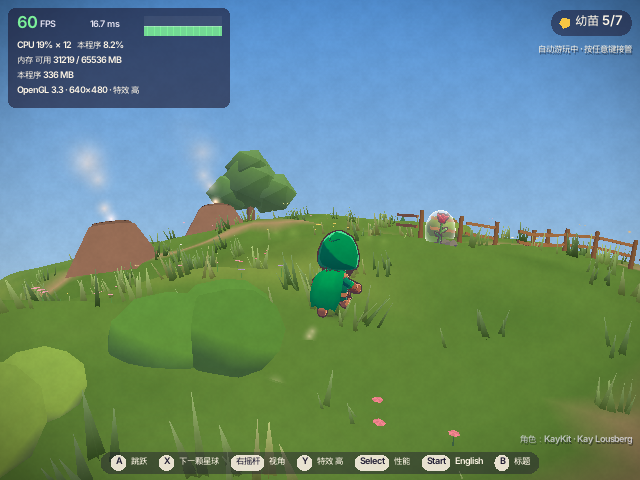
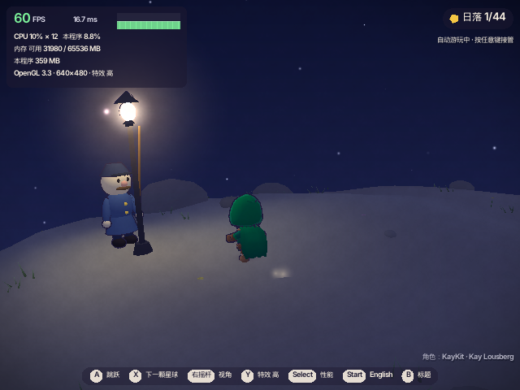
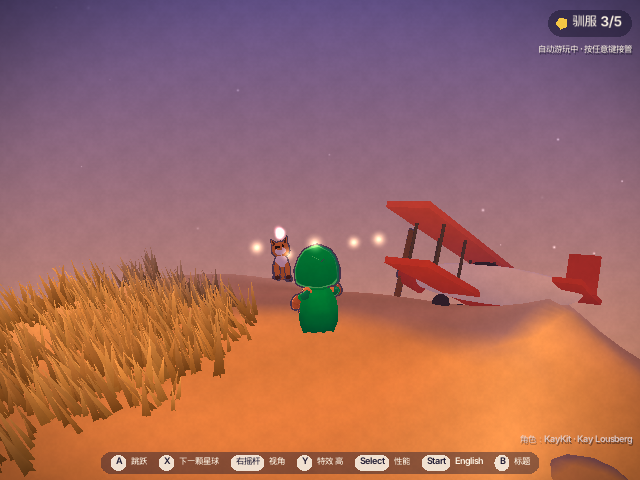

# The Little Prince · 小王子

A 3D demo for [Gizlet OS](https://github.com/gizlet/os) handhelds such as the R36S, written in Rust with raylib. A small hooded traveller walks three tiny planets, each lit by its own sun and turning through day, sunset and night, and migrating birds carry it from one planet to the next. It is a test of what a 1.3 GHz quad-core Cortex-A35 with a Mali-G31 can draw on a 640×480 screen. Nothing here is a finished game.



| Title | The lamplighter's planet | The desert |
| --- | --- | --- |
|  |  |  |

## Credits

- **The story** is Antoine de Saint-Exupéry's *Le Petit Prince* (1943). The planets follow the book: B612 with its volcanoes, rose and baobab sprouts, the lamplighter's planet, and the desert where the fox is tamed. The book is in the public domain in most countries but not everywhere, and "Le Petit Prince" is a registered trademark. Keep this demo non-commercial.
- **The hero** is the hooded Rogue from [KayKit Adventurers 1.0](https://github.com/KayKit-Game-Assets/KayKit-Character-Pack-Adventures-1.0) by [Kay Lousberg](https://www.kaylousberg.com) (CC0, [license](assets/hero/KayKit-LICENSE.txt)). Thank you! The title screen and a corner credit during play name it.
- **Everything else** is written from scratch and made in code at start-up: the planets, grass, flowers, trees, rocks, the lamplighter, the fox, the biplane, the birds, particles, shaders and sound effects.

## What it shows

| | |
| --- | --- |
| B612 | A planet nine units across with rolling hills, a dirt path, 20,000 blades of grass parting around the hero, flowers, bushes, mossy rocks, a baobab, smoking volcanoes, the rose under its glass, clouds and butterflies. Pull up the baobab sprouts. |
| The lamplighter's planet | A day lasts 14 seconds. The lamplighter lights his lamp at dusk and puts it out at dawn; the HUD counts the sunsets you watch. |
| The desert | Dunes, a wheat field, a crashed biplane and a fox that comes a little closer each time you stand still. |
| The hero | KayKit's rig with idle, walk, run, jump, landing and cheer, blended into each other and timed to the hero's speed, skinned on the GPU. |
| The look | Toon lighting with soft shadow colours, ink outlines, a sun that circles each planet, stars and shooting stars, fog, bloom and a paper texture at the high effects level. |
| The HUD | FPS with a frame-time graph, whole-machine and own CPU use, free and total memory, the app's memory, SoC temperature and CPU clock. |

## Play on a Mac

Requirements: [rustup](https://rustup.rs), CMake (raylib-sys builds raylib for the desktop) and [Git LFS](https://git-lfs.com) for the model, fonts and images.

```sh
git lfs install
git clone https://github.com/gizlet/little-prince.git
cd little-prince
cargo run --release
```

| Keys | Button | Action |
| --- | --- | --- |
| Arrows or WASD | D-pad / stick | Walk |
| Space, Enter or K | A | Jump; start on the title |
| I | X | Fly to the next planet |
| Q / E, R / F | Right stick | Turn the camera left and right, up and down |
| U | Y | Effects: high, mid, low |
| Tab | Select | Show or hide the stats |
| Esc or P | Start | 中文 / English |
| Backspace or J | B | Back to the title |

Left alone on the title for 12 seconds, it plays a demo by itself and moves on to the next planet every 26 seconds. Hold Select + Start for two seconds to quit.

| Variable | Effect |
| --- | --- |
| `GIZLET_LANG=en` | Start in English |
| `GIZLET_SWAP_AB=1` | Swap A and B |
| `LITTLEPRINCE_WINDOW=WxH` | Desktop window size (1280x960 by default) |
| `LITTLEPRINCE_DEMO=1` | Start the demo at once |
| `LITTLEPRINCE_MUTE=1` | No sound |
| `LITTLEPRINCE_FX=0\|1\|2` | Effects level (2 on the desktop, 1 on the handheld) |
| `LITTLEPRINCE_SCALE=0.8` | Render the 3D scene smaller and scale it up |
| `LITTLEPRINCE_STATS=0` | Hide the stats panel |
| `LITTLEPRINCE_HERO=Name` | Load `assets/hero/Name.glb` instead of `Rogue_Hooded` (any KayKit Adventurers 1.0 character) |
| `LITTLEPRINCE_PROFILE=1` | Print the frame time per stage (waiting for the GPU after each) and the triangles drawn, every 3 seconds; `2` prints only the frame time |
| `LITTLEPRINCE_SKIP=hero,grass,props,flowers,ground,heroink` | Leave parts out, for measuring their cost |
| `LITTLEPRINCE_CAPTURE=FILE.png` | Render one frame to a PNG and exit; `LITTLEPRINCE_SCENE` is `title`, `b612`, `lamp`, `desert`, `fly`, `model` or `icon`, and `LITTLEPRINCE_AT` the seconds of demo before it |

```sh
cargo test
```

## Run on Gizlet OS

On the device the demo links Gizlet runtime 1's `libraylib.so.600`, built for DRM with OpenGL ES 2, and reads the handheld's buttons from evdev. `scripts/package.sh` cross-builds it from a Mac with zig as the linker and assembles the app folder.

Requirements: [zig](https://ziglang.org), `rustup target add aarch64-unknown-linux-gnu`, and runtime 1's `libraylib.so`, built in [gizlet/os](https://github.com/gizlet/os) with `bazel build --config=r36s //runtime:raylib`.

```sh
GIZLET_RAYLIB_LIB=/path/to/folder/with/libraylib.so scripts/package.sh   # dist/littleprince/
scp -r dist/littleprince root@DEVICE:/opt/gizlet/apps/io.gizlet.littleprince/0.2.0
ssh root@DEVICE 'cd /opt/gizlet/apps/io.gizlet.littleprince/0.2.0 && /opt/gizlet/runtime/1/bin/gizlet-run bin/littleprince'
```

Stop the launcher first (`systemctl stop gizlet-session`) so the demo gets the screen.

### Performance on the R36S

On a genuine R36S (RK3326, Mali-G31 through Panfrost, Mesa 25.0) B612 runs at about 50 fps at the default (mid) effects level, with about 35,000 triangles a frame and about 140 MB of memory. The main thread spends about 18 ms of CPU time per frame; the high effects level (bloom, paper, the hero's outline) costs about 18 ms more.

The biggest single win was giving raylib's render batch 48 buffers in rotation instead of one (`rlLoadRenderBatch`, set with `LITTLEPRINCE_BATCH`). With one buffer, every batch flush rewrites a vertex buffer the GPU is still reading, and Panfrost makes the CPU wait for the GPU each time: about 25 ms a frame went to those waits, and the demo ran at 22 fps. The hero's skinned mesh is double-buffered for the same reason.

Other changes that helped: batching small character parts into a few draw calls, indexed meshes, cheaper small parts and far-away scenery, lighting scenery per vertex without rim light, chunking the planets so only what is in front of the camera and above the horizon is drawn, skinning the hero on the CPU, drawing straight to the screen below the high effects level, drawing opaque things without blending, the sky after the solids, and a HUD redrawn four times a second and blitted only where it holds something.

`LITTLEPRINCE_PROFILE=2` prints the frame time, the CPU time before the frame is handed over (`cpu`) and the main thread's CPU time (`thread-cpu`); `1` also splits it into stages, waiting for the GPU after each; `3` splits it without waiting. `LITTLEPRINCE_SKIP=hero,grass,props,flowers,ground,heroink,skin` leaves parts out to measure their cost.

The sky backdrop and the stars are drawn 26–30 units from the camera, well inside the far plane: on the handheld's depth buffer things near the far plane can fail the depth test and the sky flickers black.

Do not pin the GPU clock by hand: setting `min_freq` of `/sys/class/devfreq/ff400000.gpu` to its top frequency made the GPU power domain fail (`failed to get ack on domain 'gpu'`) and the screen went black until a reboot. The default `simple_ondemand` governor already reaches 560 MHz under load.

## Layout

| Path | Holds |
| --- | --- |
| `gizlet.toml` | The app manifest |
| `src/main.rs` | The window, the frame loop, captures |
| `src/app.rs` | Modes, the follow camera, the demo autopilot, flights between planets, effects from footsteps and landings, the render order |
| `src/world.rs` | The three planets: ground, scenery, the rose, sprouts, volcanoes, the lamplighter, the fox, the biplane, sky and stars |
| `src/hero.rs` | Loading the KayKit model, animation blending, bone matrices |
| `src/player.rs` | Walking on a sphere, jumps, the procedural prince used when no model is found |
| `src/gl.rs` | Shaders, materials, batching, GPU skinning, outlines, post-processing |
| `src/mesh.rs` | Mesh building, planets, grass, chunks |
| `src/fx.rs` | Particles and ripples |
| `src/sound.rs` | Synthesized sound effects |
| `src/hud.rs`, `src/text.rs` | The HUD, strings in Chinese and English, font atlases |
| `src/stats.rs` | CPU, memory, temperature and clock readings |
| `src/prof.rs` | The frame profiler |
| `src/input.rs`, `src/evdev.rs` | Keyboard, gamepads and the handheld's evdev devices (from [gizlet/overeaten](https://github.com/gizlet/overeaten)) |
| `scripts/package.sh`, `scripts/zig-cc` | The device build and app folder |
| `assets/` | The hero model, fonts and the icon |

## License

Code under MIT, see [LICENSE](LICENSE). The hero model is CC0 ([KayKit license](assets/hero/KayKit-LICENSE.txt)). Fonts: Inter and Space Grotesk under the SIL Open Font License 1.1, Droid Sans Fallback under the Apache License 2.0 ([assets/fonts](assets/fonts)).
